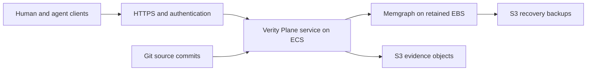

# Proposal: move artifacts and evidence to the remote service

Date: 2026-10-17

Status: proposal for review; not an approved implementation or authority switch

Inspected source: `d3b872d555f7964a3b81d5a2298f04f831826f69`

## Recommendation and scope

Make a one-time migration of `mmzen/se_harness` to an AWS-hosted service.
Use Memgraph for artifact revisions and relationships, and S3 for evidence files.

The requester states that the harness currently has no users. The migration
therefore needs to work for this repository only. A bespoke script and a runbook
are sufficient; a general migration framework is not proposed.

The first deployment serves one repository and a small number of concurrent
agent sessions. Storage integrity, decision authority and recovery still need
dependable controls. Migration simplicity does not remove those needs.

The working assumptions are that maintenance downtime is acceptable and there
is no existing AWS cluster to reuse. These assumptions, the recovery targets,
AWS account/region and operating cost remain open for review.

Publishing this proposal does not change accepted definitions, approve a work
order, accept a risk, deploy infrastructure or switch artifact authority.

## 1. Storage and authority after cutover

| Material | Authoritative location after cutover |
| --- | --- |
| Artifact revisions, relationships and lifecycle decisions | Remote service / Memgraph |
| Evidence files, logs, archives and attachments | S3, referenced by immutable manifests |
| Source code, tests, plugin instructions and deployment configuration | Git |
| Historical artifact and evidence versions | Preserved Git history, with an independent archive |
| Repository connection settings | Small repository-owned configuration pointing to the service |

The service becomes the only writer of current engineering records. Agents can
export readable files for review or evaluation. These exports are not another
writable authority.

This needs a new decision replacing the current
[DEC-HAG-004](../engineering/hosted-artifact-graph/decisions/DEC-HAG-004.md)
"Git remains authoritative" boundary. Historical decisions keep their original
meaning. The current contract continues to apply until an explicit cutover.

## 2. Existing foundations and gaps

The existing service provides immutable revisions, version checks, atomic graph
updates, retry receipts, evaluator integration and export. Reuse these mechanisms.

Three gaps prevent direct adoption:

- Lifecycle operations are explicitly restricted to test copies.
- Human decision identity is not enforced for authoritative use.
- Evidence handling is sized for small rehearsals: test snapshots are limited
  to 2 MiB and 10,000 files.

At the inspected commit, the Git tree under `docs/engineering/` contains
12,509 evidence files, totalling 570,649,486 bytes (544.21 MiB). This counts
paths containing `/evidence/`; it excludes previous versions and does not claim
to be the complete dependency inventory for migration. The largest evidence
file is 38,637,157 bytes. The other 2,124 engineering files total 11.72 MiB;
that count includes indexes and is not a formal-artifact count.

These measurements come from Git blob sizes returned by
`git ls-tree -rlz` at the inspected commit, not a converted working tree.

The size limits are in
[pilot_git.py](../../server/hosted_artifact_graph/pilot_git.py).
The current graph stores test snapshot payloads in
[store.py](../../server/hosted_artifact_graph/store.py).
Replace this evidence mechanism instead of merely increasing the limits.

The existing service separately pins evaluator 0.22.1. The repository currently
selects 0.23.0. A future supported combination must explicitly select, release
and qualify the evaluator changes described below; version substitution is not
implicit in this proposal.

## 3. Proposed AWS hosting

Start with ECS on one EC2 host. Keep persistent data separate from disposable
containers.

| Component | Initial proposal |
| --- | --- |
| Compute | One ECS EC2 host; initially test 2 vCPU / 8 GiB RAM against the full repository |
| Containers | Existing Python service and Memgraph, with pinned image digests |
| Database storage | Encrypted EBS data volume, retained independently of task and instance replacement |
| Evidence | Private, versioned S3 bucket |
| Entry point | HTTPS with authentication; database ports remain private |
| Operations | ECR images, CloudWatch logs and alarms, infrastructure defined in code |

Keep one active database writer. Updates stop and replace containers against
the retained volume. They must not start a second database against the same
files. Task placement and startup checks must require the correct mounted data
volume and must refuse an empty replacement store. Host failure needs a
documented recovery procedure. This initial design does not promise automatic
failover or uninterrupted availability.

Defer Kubernetes unless an existing cluster changes the cost and operating
trade-off. EKS standard control-plane pricing is $0.10 per hour, approximately
$73 for 730 hours, before compute and storage. ECS orchestration has no additional
service charge. These are service pricing facts, not an estimate of this full
deployment. Sources: [EKS pricing](https://aws.amazon.com/eks/pricing/) and
[ECS pricing](https://aws.amazon.com/ecs/pricing/).

Fargate is an option for the application service later. Do not place the
authoritative database on an ordinary ECS-managed EBS service volume: AWS
documents that these volumes are deleted when their service tasks terminate.
Use an independently retained volume mounted through an explicit host path.
Sources: [ECS EBS volumes](https://docs.aws.amazon.com/AmazonECS/latest/developerguide/ebs-volumes.html)
and [ECS bind mounts](https://docs.aws.amazon.com/AmazonECS/latest/developerguide/bind-mounts.html).

Before implementation, estimate compute, EBS, the HTTPS entry point, networking,
logs, backups and any Memgraph licence for the chosen region. Validate the
initial host size against the actual import and concurrent evaluation workload.

## 4. Minimum controls for authoritative use

| Area | Proposed required behavior |
| --- | --- |
| Identity | Authenticate the human and each agent. Derive identity from credentials, not a submitted actor name. |
| Decisions | Agents may prepare work and apply a recorded human decision. Their credentials cannot independently approve, verify or release. |
| Human review | Provide an authenticated review link bound to the exact candidate and artifact revisions. |
| Writes | Preserve version guards and retry receipts. Stale inputs fail without partial changes. |
| Evidence | Store immutable objects with SHA-256, size and S3 version references. Verify bytes when retrieving them. |
| Cypher | Retain it with a separately enforced read-only database connection. Confirm support and licensing for the selected Memgraph version. |
| Failure | An unavailable service stops governed writes. There is no silent fallback to local authoritative files. |
| Recovery | Restore the graph, evidence references, decision history and retry receipts together. Test this before migration. |

Cognito is a proposed managed authentication option. It supports browser-based
authorization with PKCE for public clients. Keep the human's decision credentials
outside the agent runtime. A human decision should name the immutable inputs
being approved; an agent may submit the recorded decision only while they match.
Source: [Cognito token endpoint](https://docs.aws.amazon.com/en_en/cognito/latest/developerguide/token-endpoint.html).

For evidence, use conditional writes, versioning and deletion restrictions.
Add S3 Object Lock in governance mode for retained evidence and backups, with
bypass permission excluded from the application role. References select exact
versions: Object Lock does not prevent creation of a newer version at the same
key. Retention duration and administrative recovery rights must be agreed before
enabling the bucket policy. Sources:
[conditional writes](https://docs.aws.amazon.com/us_en/AmazonS3/latest/userguide/conditional-writes.html)
and [Object Lock](https://docs.aws.amazon.com/AmazonS3/latest/userguide/object-lock.html).

Evidence acceptance uses this order:

1. Upload and verify the immutable object.
2. Commit its reference, artifact changes and operation receipt in one graph transaction.
3. Return the accepted receipt.

A failed graph transaction may leave an unused object. It must never leave an
accepted record pointing to missing evidence. A lost response after commit
returns the same receipt on retry. Evidence transfer should be bounded and
streamed, not embedded in a large JSON snapshot. Keep automated deletion of
unused objects out of the initial implementation unless it is needed.

### Recovery targets for review

Propose at most 15 minutes of lost updates after total storage loss and
restoration within four hours. These are proposed acceptance targets, not
current guarantees or accepted risks. Schedule consistent backups frequently
enough to meet the target and alert on overdue or failed backups.

Process restarts should preserve acknowledged transactions using the existing
synchronous WAL configuration. Qualify power loss, storage loss and restore
separately on the selected deployment. Backups must retain the immutable evidence
versions referenced by their graph snapshot, component identities and restore
instructions. Source:
[Memgraph durability configuration](https://memgraph.com/docs/database-management/configuration).

## 5. Preserve real verification provenance

A new verification record should bind:

- the real source-code Git commit;
- the immutable remote artifact baseline;
- the evidence manifest digest;
- the selected evaluator and policy identities.

The current disposable test Git commits must not substitute for real
implementation commits. Extend and release the evaluator's provenance contract
first. The service continues to invoke that evaluator and does not acquire a
second set of lifecycle rules.

CI and PR checks consume the selected immutable remote baseline, rather than
whatever is current when a job starts. Required inputs becoming unavailable
produce an explicit failure, not a weaker result. Historical records retain
their original Git bindings and use the preserved historical resolver.

## 6. One-time migration procedure

Use one repository-specific script and a runbook.

1. **Inventory the source.** Identify artifacts, evidence, historical references
   and unfinished branches. Select an exact Git commit. Include referenced
   supporting files outside the obvious artifact and evidence directories.
2. **Preserve history.** Create a complete Git archive/bundle with the required
   refs. Verify that historical artifacts and evidence remain resolvable.
3. **Rehearse the import.** Import into a disposable remote project. Preserve
   IDs, statuses, ownership, decisions and exact file bytes. Do not replay old
   approvals as new decisions. Record the source commit, original path, blob
   identity and content digest for each imported item.
4. **Check equivalence.** Compare counts, hashes, relationships and evaluator
   results. Restore the imported project from backup and repeat the comparison.
5. **Freeze engineering-record writes briefly.** Account for open branches:
   integrate them, import their drafts into separate contexts, or explicitly
   defer them. Do not silently discard their work.
6. **Perform the final import and switch.** Record the source commit, destination
   project, imported baseline and explicit authority-switch decision. Enable
   remote writes and reject legacy local writes.
7. **Remove active Git copies in a normal PR.** Preserve historical Git commits.
   Update CI, plugin discovery and review links to use the remote service.

The script should support a dry run and a safe restart for this exact source
and destination. It should refuse conflicting imported bytes or a different
source identity. It does not need to support arbitrary repositories or a
general series of schema upgrades.

There is no period with two authoritative writers.

Before remote writes begin, rollback restores the previous configuration.
After remote writes begin, rollback first freezes and exports the new records
and decisions, then validates the restored Git-based representation. Returning
directly to the old Git snapshot would lose work.

Removing files in a new commit does not shrink existing Git history. History
rewriting is not proposed. Git remains the independent historical archive;
importing every historical revision into the live graph is not necessary.

## 7. Suggested implementation packages

| Package | Concrete outcome |
| --- | --- |
| Authority and provenance | Approved remote-authority model; evaluator support for code commit, artifact baseline and evidence manifest |
| Durable storage and access | S3 evidence adapter, real identities, human decision enforcement and protected Cypher |
| AWS deployment and recovery | Reproducible deployment, monitoring, backups and demonstrated restore |
| Client and review integration | Repository selection, agent discovery, CI checks and accessible human review |
| Migration and adoption | Bespoke importer, successful rehearsal, explicit cutover and removal of active Git copies |

These are proposed work packages, not allocated or approved work orders.
The evaluator changes must be released and selected before they govern the
authoritative service. Qualify the exact client/plugin/service/evaluator/database
combination before cutover. Reuse existing qualified behavior where applicable;
do not claim that sandbox qualification proves authoritative operation.

The acceptance exercise is one real, small change completed through the remote
store. It includes concurrent edits, an interrupted upload, a lost response,
human verification, PR review and restore. Also prove that an agent credential
cannot supply a human approval and that the Cypher read connection cannot write.

## 8. Open decisions

- Accept maintenance downtime, or require automatic failover?
- Which AWS account and region, and is there a reusable ECS/EKS cluster?
- Accept or revise the proposed 15-minute data-loss and four-hour recovery targets?
- Which authenticated human review flow and agent credential mechanism?
- Which Memgraph edition/version provides the enforced Cypher boundary, at what cost?
- Which evidence retention periods, backup retention and administrative recovery rights?
- Which unfinished branches need inclusion in the final migration?

The earlier authentication and database-ACL deferrals applied to a private test
copy. They do not silently carry into authoritative operation. Resolve
[RISK-HAG-001](../engineering/hosted-artifact-graph/risks/RISK-HAG-001.md) and the
[SPEC-HAG-003 cutover prerequisites](../engineering/hosted-artifact-graph/specifications/SPEC-HAG-003.md#hag-ops-006--authority-release-and-next-phases)
through the later formal package, preserving historical decisions.

## 9. KIS boundary

One repository, one service, one database writer, one evidence bucket and one
migration. Defer multi-tenancy, automatic failover, bidirectional synchronization
and a general migration framework. Reconsider these exclusions only when an
actual operating requirement justifies them.
